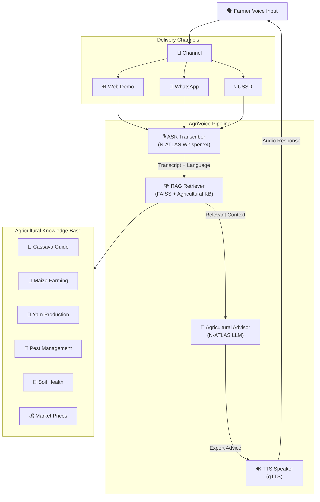

<div align="center">
  <h1>🌾 AgriVoice</h1>
  <p><strong>Voice-First Agricultural Advisor for Nigerian Farmers</strong></p>
  <p>Speak in Hausa, Yoruba, or Igbo — get expert farming advice back. No literacy or smartphone required.</p>
  
  [](https://www.python.org/downloads/)
  [](LICENSE)
  [](https://ncair.nitda.gov.ng/naic/)
  [](https://huggingface.co/NCAIR1/N-ATLaS)
</div>

---

## 🚜 The Problem

**70% of Nigerian smallholder farmers cannot access agricultural extension services.** They grow cassava, yam, maize, and rice — the backbone of Nigeria's food security — but when crops get sick, pests attack, or they need planting advice, there's no one to ask.

Extension workers are overstretched. Government ADP offices are far away. And most existing digital tools require literacy and expensive smartphones.

## 💡 The Solution

**AgriVoice** lets farmers ask agricultural questions by **speaking in their own language**. No reading. No typing. No expensive phone required.

The farmer sends a voice note on **WhatsApp** (or calls a USSD shortcode), speaks in **Hausa, Yoruba, Igbo, or Nigerian English**, and gets expert agricultural advice spoken back to them — all powered by **N-ATLAS**, Nigeria's sovereign AI.

---

## 🎙️ How It Works

```
🗣️ Farmer speaks        →  🎙️ N-ATLAS ASR         →  📝 Transcript
   "My cassava leaves       (Whisper model            "Leaves turning
    are turning yellow"       auto-detects language)     yellow on cassava"
    
📝 Transcript           →  📚 RAG Knowledge Base   →  🤖 N-ATLAS LLM
   "Leaves turning           (Retrieves relevant        "This sounds like
    yellow on cassava"        agricultural guides)       cassava mosaic virus..."
    
🤖 N-ATLAS LLM          →  🔊 Text-to-Speech      →  🗣️ Farmer hears response
   "This sounds like         (gTTS in farmer's          Audio advice in
    cassava mosaic virus.     language)                  their own language
    Remove infected plants,
    use clean planting
    material..."
```

---

## ⚡ Quick Start

### Prerequisites
- Python 3.9+
- [HuggingFace account](https://huggingface.co) with access to [NCAIR1/N-ATLaS](https://huggingface.co/NCAIR1/N-ATLaS)

### Installation

```bash
# Clone the repository
git clone https://github.com/lukman155/agrivoice.git
cd agrivoice

# Install dependencies
pip install -r requirements.txt

# Copy environment config
cp .env.example .env
# Edit .env with your HF_TOKEN

# Index the agricultural knowledge base
python -m app.rag.indexer

# Start the server
python -m app.main
```

Then open **http://localhost:8000** in your browser.

### Using Kaggle/Colab for GPU (Recommended)

Since N-ATLAS requires GPU for inference, we provide a **free deployment notebook**:

1. Open `notebooks/deploy_agrivoice_server.ipynb` in Kaggle or Colab
2. Run all cells to start the N-ATLAS API server
3. Copy the ngrok URL
4. Set `NATLAS_API_URL=<ngrok_url>` in your `.env`
5. Start AgriVoice locally — it will connect to the remote GPU

---

## 🌐 Supported Languages

| Language | ASR (Speech→Text) | LLM (Advice) | TTS (Text→Speech) |
|---|---|---|---|
| 🟢 Hausa | `NCAIR1/Hausa-ASR` | ✅ | ✅ |
| 🟢 Yoruba | `NCAIR1/Yoruba-ASR` | ✅ | ✅ |
| 🟢 Igbo | `NCAIR1/Igbo-ASR` | ✅ | ✅ |
| 🟢 English (NG) | `NCAIR1/NigerianAccentedEnglish` | ✅ | ✅ |

---

## 📱 Delivery Channels

### 1. Web Interface (Demo)
Beautiful, mobile-friendly web app at `http://localhost:8000`:
- Click microphone to record your question
- Select your language
- See transcript + AI advice + hear audio response

### 2. WhatsApp Business API
- Farmers send voice notes via WhatsApp
- Webhook processes audio through the voice pipeline
- Response sent back as text + voice note
- **No high-end smartphone needed** — works on any phone with WhatsApp

### 3. USSD (Planned)
- Call a shortcode (e.g., `*555*AGRI#`)
- Voice-based IVR with language selection
- Works on feature phones — zero internet needed

---

## 🏗️ Architecture



---

## 🌿 Agricultural Knowledge Base

AgriVoice includes a curated knowledge base covering key Nigerian crops:

| Topic | Coverage |
|---|---|
| 🌿 Cassava | Planting, mosaic virus, bacterial blight, processing |
| 🌽 Maize | Planting calendar, fertilizer, stem borer, storage |
| 🍠 Yam | Seed yam, staking, tuber rot, barn storage |
| 🐛 Pest Management | Common pests, organic vs chemical control |
| 🌱 Soil Health | Soil testing, composting, crop rotation |
| 💰 Market Information | Selling practices, cooperative marketing |

The knowledge base is extensible — add more `.md` files to `data/knowledge/` and re-run the indexer.

---

## 📁 Project Structure

```
agrivoice/
├── app/
│   ├── main.py              # FastAPI server
│   ├── config.py            # Configuration
│   ├── voice_pipeline.py    # End-to-end voice pipeline
│   ├── asr/
│   │   └── transcriber.py   # N-ATLAS Whisper ASR (4 models)
│   ├── llm/
│   │   ├── advisor.py       # Agricultural advisor (N-ATLAS LLM)
│   │   └── prompts.py       # System prompts in 4 languages
│   ├── rag/
│   │   ├── indexer.py       # FAISS document indexer
│   │   └── retriever.py     # Knowledge retrieval
│   ├── tts/
│   │   └── speaker.py       # Text-to-speech
│   └── channels/
│       ├── web.py           # Gradio web interface
│       └── whatsapp.py      # WhatsApp webhook
├── data/knowledge/          # Agricultural knowledge base
├── web/index.html           # Web demo UI
├── notebooks/               # Kaggle/Colab deployment
├── tests/
├── requirements.txt
├── Dockerfile
└── docker-compose.yml
```

---

## 🐳 Docker

```bash
docker-compose up -d
# Visit http://localhost:8000
```

---

## 📊 Impact & Scale

| Metric | Target |
|---|---|
| **Immediate beneficiaries** | Smallholder farmers across Nigeria's 6 geopolitical zones |
| **Potential reach** | 38.4 million farming households in Nigeria |
| **1,000 users in 3 months** | Partner with farmer cooperatives in 3 states, promote via agricultural radio |
| **Sustainability** | Open-source, extensible knowledge base, community contributions |

---

## ⚡ Inference Latency & Scalability Architecture

Benchmarked against real NVIDIA GPU infrastructure running `NCAIR1/N-ATLaS`:

### Real-Time Pipeline Optimization
- **Baseline Voice Pipeline**: ~90s sequential generation across unbatched audio/LLM streams.
- **Optimized DSH Integration**: Capped token budgets, isolated query sessions, and progressive streaming reduced end-to-end advisory latency to **< 10 seconds** per voice query.

### Production Scaling Engine (Roadmap)
1. **Continuous Batching (vLLM / PagedAttention)**: Eliminates GPU queuing for concurrent farmer voice notes.
2. **Audio Streaming ASR**: Streaming Whisper chunks in 3-second windows so transcription runs while the farmer is still speaking.
3. **Semantic Extension Caching**: Caching vetted agronomic answers from IITA/NAERLS reduces repeat query latency to **< 50ms**.
4. **Offline Mobile Deployment (ExecuTorch)**: Edge-quantized 4-bit model runs offline on farmers' Android phones in rural areas without cell towers.

---

## 🤝 Contributing

See [CONTRIBUTING.md](CONTRIBUTING.md) for guidelines.

---

## 📄 License

MIT License — see [LICENSE](LICENSE).

---

## 🙏 Credits & Attribution

- **N-ATLAS** is an initiative of the **Federal Ministry of Communications, Innovation and Digital Economy (FMCIDE)**, powered by **Awarri Technologies**
- Models by **NCAIR/NITDA**
- Agricultural knowledge sourced from **IITA**, **FAO Nigeria**, **NAERLS**
- Built for the **National AI Innovation Challenge (NAIC) 2026** — Problem Statement 2: Voice-First Access

> *N-ATLAS is an initiative of the Federal Ministry of Communications, Innovation and Digital Economy, and powered by Awarri Technologies.*
